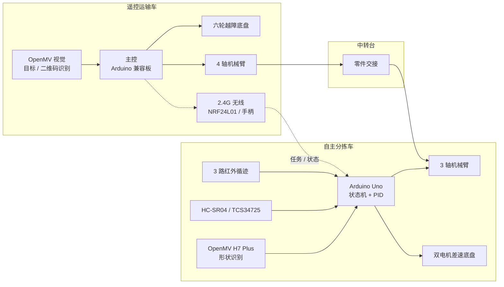
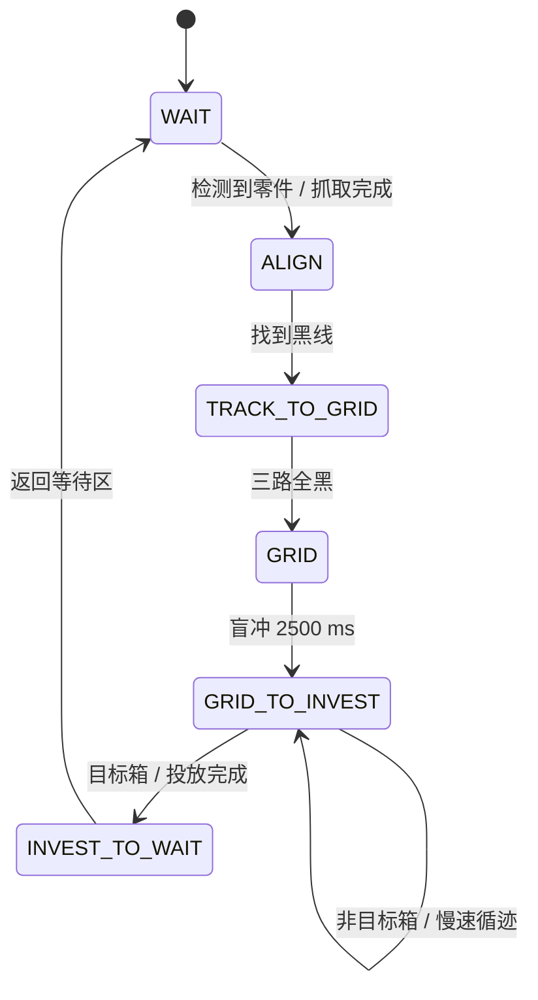

# Smart Sort 全地形自适应机器人（省赛）

> 中国机器人及人工智能大赛 · 全地形自适应机器人赛项省赛作品 —— 遥控运输车 + 自主分拣车双机协同，完成目标识别、抓取、越障、中转、循迹与分类投放。

[](LICENSE)
[](https://platformio.org/)
[](https://openmv.io/)

## 项目简介

本项目面向复杂地形下的零件分拣与转运任务，由两台机器人分工协作：

- **遥控运输车**：在扫码区完成目标识别，进入零件堆放区抓取目标零件，通过二级台阶与栅格区，将零件运送至中转台；
- **自主分拣车**：从中转台自动取件，沿黑色引导线循迹，按目标类型完成分类投放，随后返回等待区准备下一轮任务；
- 两车通过无线链路与任务信号衔接，形成「人工辅助 + 自主运行」的协同流程。

本仓库为省赛阶段固件与资料的整理归档，包含自主分拣车完整固件、遥控端调试代码、OpenMV 视觉脚本，以及一份**已删除院校与个人身份信息**的整理版设计报告。

## 系统架构



## 目录结构

```
smart-sort-robot/
├── autonomous-robot/            # 自主分拣车固件（PlatformIO / Arduino Uno）
│   ├── src/main.cpp             #   主状态机
│   ├── lib/
│   │   ├── Infrared_recognition/#     三路红外循迹与误差映射
│   │   ├── pid/                 #     PID 计算
│   │   ├── motor_drive/         #     数字 / PWM 电机驱动
│   │   ├── arm_drive/           #     三轴机械臂（ServoTimer2）
│   │   ├── hc_sr04/             #     超声波测距
│   │   ├── color_recognition/   #     TCS34725 颜色识别
│   │   ├── openmv/              #     OpenMV 串口通信封装
│   │   ├── MH_TCS34725/         #     TCS34725 驱动库（随仓库提供）
│   │   └── pinout/              #     引脚定义
│   ├── examples/                #   比赛期间的调试例程（非 PlatformIO 测试）
│   └── platformio.ini
├── remote-control-robot/        # 遥控运输车端代码（归档不完整，见下文）
│   ├── src/main.cpp             #   单路传感器触发调试示例
│   ├── lib/
│   │   ├── rc/                  #     摇杆模拟量读取
│   │   ├── nrf24L01/            #     无线模块占位代码
│   │   ├── SoftwareSerial/      #     Arduino 软件串口库
│   │   └── pinout/              #     引脚定义
│   └── platformio.ini
├── vision/
│   └── openmv/                  # OpenMV H7 Plus 视觉脚本（MicroPython）
│       ├── main.py              #   2D 图形 / 3D 物块识别主程序
│       ├── shape_detector.py    #   基于最小外接矩形的形状分类
│       ├── Material_identification.py
│       ├── detect_black_shapes.py
│       └── ArduinoUart.py       #   官方 UART 通信示例
├── docs/
│   └── design-report.md         # 脱敏整理版设计报告
├── LICENSE
└── README.md
```

## 硬件清单

| 部件 | 型号 / 规格 | 用途 |
| --- | --- | --- |
| 主控（自主车） | Arduino Uno / ATmega328P | 循迹、状态机、机械臂与传感器控制 |
| 主控（遥控车） | Arduino 兼容 Basra 主控板 | 遥控端控制（归档固件为调试片段） |
| 视觉模块 | OpenMV H7 Plus | 二维图形 / 立体物块识别，UART 115200 |
| 循迹传感器 | 3 路红外（数字 / 模拟） | 黑线检测，接 A0 / A2 / A3 |
| 测距模块 | HC-SR04 | 等待区、中转台与箱子检测 |
| 颜色传感器 | TCS34725（I2C） | 颜色识别，接 A4 / A5 |
| 电机驱动 | 双路直流电机 + PWM | 差速驱动 |
| 舵机 | 3 个（俯仰 / 伸缩 / 夹爪） | 三轴机械臂，接 D4 / D7 / D11 |
| 无线模块 | NRF24L01 / 2.4G 手柄 | 遥控与双车协同（原设计） |
| 显示模块 | 0.96 寸 OLED | 遥控端状态与识别结果显示 |
| 电源 | 7.4V 锂电池 | 整车供电 |

## 自主分拣车控制逻辑

### 状态机



| 状态 | 行为 | 退出条件 |
| --- | --- | --- |
| `STATE_wait` | 停车等待，超声波监测零件 | 距离 < 25 cm 连续确认 300 次 → 抓取 → `ALIGN` |
| `STATE_ALIGN` | 原地左转寻找黑线 | 任一红外检测到黑线并确认 100 次 → `TRACK_TO_GRID` |
| `STATE_TRACK_TO_GRID` | 正常速度 PID 循迹（基础 250 / 限幅 255） | 三路全黑确认 50 次 → `GRID` |
| `STATE_GRID` | 左右同速 255 盲冲通过网格 | 2500 ms 后停车 → `GRID_TO_INVEST` |
| `STATE_GRID_TO_INVEST` | 慢速 PID 循迹（200 / 200），统计箱子 | 命中目标箱 → 投放 → `INVEST_TO_WAIT` |
| `STATE_INVEST_TO_wait` | 强制找回黑线 → 循迹 → 后退 200 ms → 左转寻线 → 循迹 → 前进 300 ms 停车 | 完成 → `WAIT` |

### 投放策略

程序用 `global_run_cycle`（1 → 2 → 3 → 1）记录多轮运输的目标箱序号：

| 轮次状态 | 投放目标 | 投放后 |
| --- | --- | --- |
| 1 | 第 1 个检测到的箱子 | → 2 |
| 2 | 第 3 个检测到的箱子 | → 3 |
| 3 | 第 3 个检测到的箱子 | → 1 |

箱子计数通过超声波「未检测 → 检测到」的上升沿去重，避免同一箱子被重复计数。

### 关键参数

| 参数 | 值 | 说明 |
| --- | --- | --- |
| PID | `Kp = 200, Ki = 0, Kd = 100` | 误差范围 -3 ~ +3 |
| 正常循迹 | 基础 250，限幅 255 | 网格前路段 |
| 慢速循迹 | 基础 200，限幅 200 | 投放区路段 |
| 盲冲 | 速度 255，时长 2500 ms | 通过网格 |
| 超声波触发距离 | 25 cm | 等待区与箱子检测 |
| 投放确认次数 | 20 次 | 防止误触发 |
| 等待区确认次数 | 300 次 | 防止误抓取 |
| 直角弯后退补偿 | 200 ms | 防止车头冲出赛道 |

## 视觉识别（OpenMV）

`vision/openmv/main.py` 运行在 OpenMV H7 Plus 上，使用灰度 QVGA（320×240）与固定 ROI，支持两种工作模式：

- **状态 2：二维图形识别**——在白色背景中提取黑色图形，按色块像素面积与最小外接矩形面积的比值（`true_extent`）分类：
  - `true_extent ≥ 0.86` → `Square`
  - `0.65 ≤ true_extent < 0.86` → `Circle`
  - `true_extent < 0.65` → `Triangle`
- **状态 1：立体物块识别**——在黑色背景中提取白色物块，结合外接矩形与角度特征判断对应横截面形状。

主控通过 UART 发送 `1` / `2` 切换模式：状态 1 返回 `Circle` / `Square` / `Triangle` 等形状字符串，状态 2 在二维图形与目标匹配成功时返回 `3`。接线与波特率见 [vision/openmv/README.md](vision/openmv/README.md)。

## 遥控运输车端代码说明

> **注意：本目录不是完整的遥控车固件。** 省赛归档时仅保留了以下片段：
>
> - `src/main.cpp`：单路红外 / 传感器触发示例（读取 A0，串口打印 `#`）；
> - `lib/rc/`：四路摇杆模拟量读取函数；
> - `lib/nrf24L01/`：引脚初始化占位代码，未实现 NRF24L01 寄存器驱动。
>
> 完整的无线遥控、机械臂与 OLED 显示逻辑未包含在归档中。遥控车的机械结构与控制方案见设计报告第 2、3 章。

## 快速开始

### 自主分拣车

```bash
cd autonomous-robot
pio run               # 编译
pio run -t upload     # 烧录（默认 /dev/ttyUSB0 或 COMx）
pio device monitor    # 串口监视，波特率 9600
```

- `platformio.ini` 已声明 `ServoTimer2` 依赖，首次编译需联网下载；
- `MH_TCS34725` 驱动已随仓库放在 `lib/` 下，无需额外安装；
- 最终版 `main.cpp` 使用 9600 波特率；OpenMV 相关例程使用 115200，注意区分。

### OpenMV 视觉

1. 用 OpenMV IDE 打开 `vision/openmv/main.py`，另存到 OpenMV 文件系统为 `main.py`；
2. 接线：OpenMV `P4 (TX)` → Arduino `RX (D0)`，`P5 (RX)` → Arduino `TX (D1)`，两板共地；
3. 注意 UART 与 Arduino USB 串口共用 D0/D1，烧录或串口调试时需断开 OpenMV。

### 遥控端

```bash
cd remote-control-robot
pio run -t upload
```

仅用于验证摇杆采样与串口输出，完整遥控功能需自行补全。

## 已知问题

- **遥控端固件不完整**：`nrf24l01.cpp` 只是把 4 个模拟引脚设为输入，并非真正的 NRF24L01 驱动；`main.cpp` 是单路传感器触发示例。
- **颜色传感器与超声波引脚冲突**：TCS34725 使用 I2C（A4 = SDA、A5 = SCL），而 HC-SR04 的 `ECHOPIN` / `TRIGGER` 也定义为 A4 / A5，二者不能同时使用，实际使用时需改线。
- **投放轮次注释与逻辑不一致**：`global_run_cycle == 3` 分支注释写「第一次检测到箱子就投掷」，实际条件是 `box_appearance_count == 3`（第 3 个箱子）。
- **PID 积分项写法非标准**：`I = I + previous_I` 不是常规离散积分；当前 `Ki = 0`，对运行无影响，但改 `Ki` 前应先修正。
- **无编码器闭环**：底盘为 PWM 差速 + 循迹误差 PID，不是轮速闭环。
- **视觉与主控共用 UART0**：调试与烧录时存在冲突，需断开视觉模块。

## 设计报告

- [docs/design-report.md](docs/design-report.md) —— 在原比赛报告基础上整理，已删除院校与个人身份信息，并按实际固件补充了实现细节、参数与差异说明。
- 原始 Word 报告未包含在本仓库中。

## 说明

本仓库为赛后归档，代码保留比赛现场版本，未做重构。报告中的部分设计描述与归档代码存在差异（主控平台、循迹路数、二维码识别等），已在设计报告附录中逐项说明。

## License

[MIT](LICENSE) © 2026 Smart Sort Team

仓库中包含的第三方库（MH_TCS34725、SoftwareSerial 等）按各自许可证分发，详见 [THIRD_PARTY_NOTICES.md](THIRD_PARTY_NOTICES.md)。
