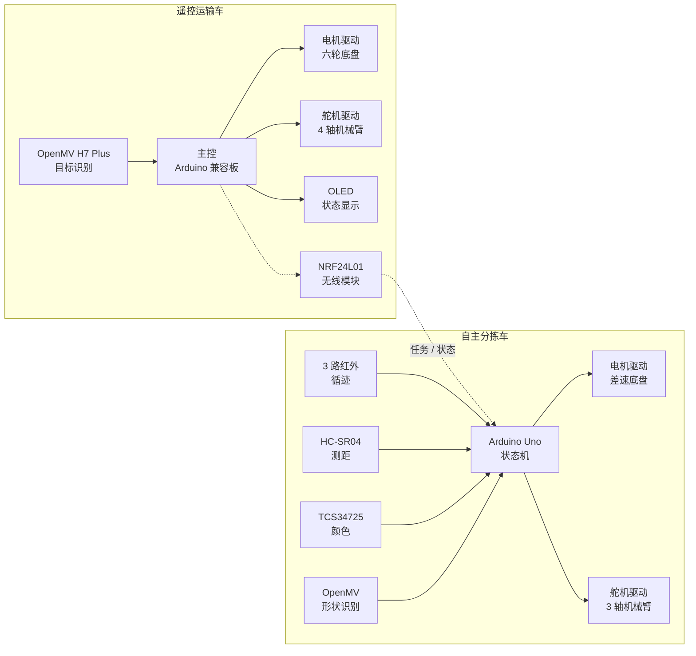
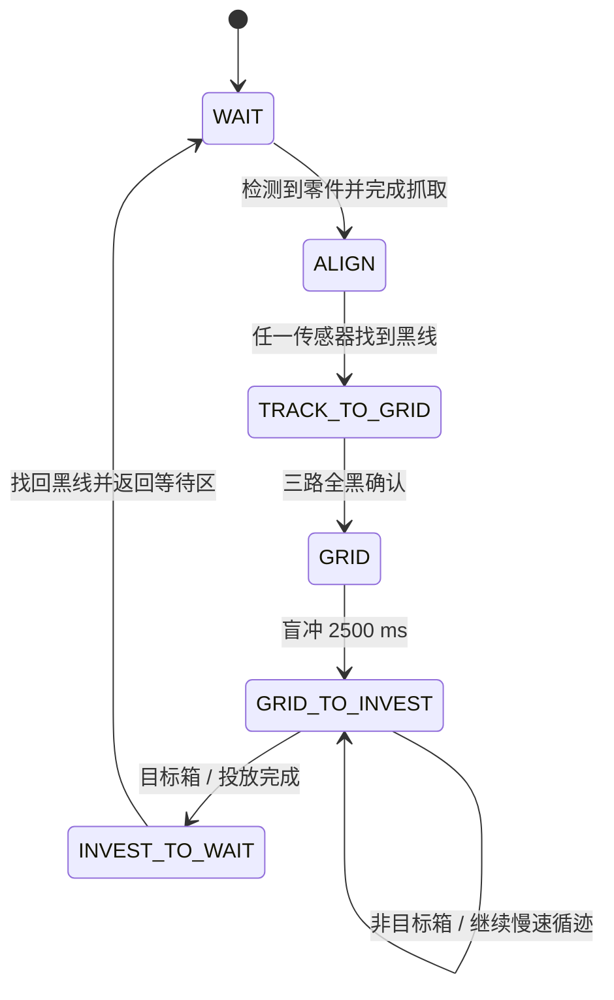

# 全地形自适应机器人设计报告

> **赛事**：中国机器人及人工智能大赛 · 全地形自适应机器人赛项（省赛）  
> **参赛队伍**：Smart Sort  
> **文档版本**：整理版 · 2026-10  
> **文档说明**：本报告在原参赛设计报告的基础上整理，已删除院校信息与个人身份信息；同时按仓库中的实际固件补充、校订了实现细节。原报告与归档代码存在差异的部分，统一列于[附录 8.4](#84-与原报告的差异说明)。

---

## 摘要

面向复杂地形下的零件识别、搬运与分类投放任务，本文设计了一套由**遥控运输车**与**自主分拣车**组成的双机器人协同系统。遥控车负责目标识别、零件抓取、二级台阶与栅格区越障及中转运输；自主车负责黑线循迹、中转台取件、目标分类与自动投放。系统采用模块化机械结构、差速/履带底盘、多传感器融合与有限状态机控制，在限定场地内完成「识别—抓取—越障—中转—循迹—投放—返回」的完整任务闭环。

省赛调试与场地测试表明，系统能够稳定完成多轮运输任务；同时，报告也如实记录了调试中暴露的引脚冲突、无线固件不完整、无线通信方案迭代等问题，供后续改进参考。

**关键词**：全地形机器人；双机协同；PID 循迹；有限状态机；OpenMV；机械臂

---

## 1 作品简介

### 1.1 项目背景

随着智能制造与工业自动化的发展，零件分类、搬运与回收已成为生产物流中的关键环节。复杂工厂环境通常同时存在台阶、栅格、窄通道等非结构化地形，单一机器人难以兼顾越障、抓取与分类投放。

本项目以比赛场地为背景，设计一套双机器人协同系统：由遥控车承担复杂地形下的抓取与运输，由自主车承担规则赛道上的循迹与分类投放，从而把「高难度越障」与「高精度重复作业」拆分给两台各有所长的机器人。

### 1.2 设计目标

1. 完成扫码区的目标信息识别与零件类型确认；
2. 实现二级台阶、栅格区、窄通道等复杂地形下的稳定运行与越障；
3. 完成正方体、圆柱体、正三棱柱等不同形状零件的抓取与中转；
4. 实现自主车沿黑线的稳定循迹与分类投放；
5. 提高机器人运行稳定性与任务完成效率；
6. 实现双机器人之间的信息协同与任务衔接；
7. 在限定时间内尽可能提高比赛得分。

### 1.3 系统总体方案

系统由遥控运输车、自主分拣车、视觉识别模块、无线通信模块、机械抓取机构与主控系统组成，各子系统职责如下：

| 子系统 | 主要任务 | 关键实现 |
| --- | --- | --- |
| 遥控运输车 | 扫码识别、零件抓取、越障、运输至中转台 | 六轮越障底盘、4 轴机械臂、OpenMV、OLED |
| 自主分拣车 | 中转台取件、循迹、分类投放、返回等待区 | 三路红外、PID 差速、3 轴机械臂、超声波 |
| 视觉识别 | 目标形状 / 物块识别 | OpenMV H7 Plus + MicroPython |
| 无线通信 | 目标类型、任务信号、状态反馈 | NRF24L01 / 2.4G（原设计） |
| 机械抓取 | 多形状零件夹持 | 舵机夹爪 + 橡胶防滑层 |
| 主控 | 传感器采集、状态机、执行器控制 | Arduino 兼容主控 + PlatformIO |

整个系统采用「人工辅助 + 自主运行」的协同模式：操作手通过遥控车完成高难度越障与抓取，自主车在规则赛道上完成重复性运输与投放。

### 1.4 工作流程说明

1. 比赛开始后，遥控车进入扫码区，通过视觉模块读取目标信息，并在 OLED 上显示目标零件类型；
2. 遥控车进入零件堆放区，利用机械臂抓取目标零件；
3. 遥控车携带零件通过二级台阶与栅格区，将零件放置于中转台；
4. 自主车在等待区通过超声波检测到零件后，执行抓取动作；
5. 自主车原地旋转寻找黑线，进入正常速度 PID 循迹；
6. 检测到十字标志线后，自主车加速盲冲通过网格区，转入慢速循迹；
7. 自主车根据当前轮次，在第 1 个或第 3 个箱子处停车并执行投放；
8. 投放完成后，自主车找回黑线、通过直角弯并返回等待区，准备下一轮任务。

---

## 2 结构方案设计

### 2.1 总体结构设计

机器人整体采用模块化设计，分为底盘模块、驱动模块、抓取模块、控制模块与传感器模块。模块化结构便于维护与功能扩展，同时降低单点故障对整车的影响。

设计重点考虑以下问题：

- **越障能力**：大直径轮胎、履带底盘与前置大轮布局；
- **运行稳定性**：低重心、重心居中、关键部件对称布置；
- **结构轻量化**：铝合金型材 + 3D 打印件；
- **抓取可靠性**：夹爪防滑、关节限位、动作平滑；
- **可装配性**：标准件为主，便于现场维修与更换。

机器人主体框架采用铝合金结构件搭建，在保证强度的同时减轻整体重量。

### 2.2 遥控机器人结构设计

遥控车采用**六轮联动驱动的月球车底盘**，前部布置一组大直径轮胎以提高越障能力，后轮提供主要动力。车体前部安装机械臂与视觉模块，中部布置主控系统与电池，后部布置通信模块与辅助支撑结构。

抓取机构为 **4 轴机械臂**：旋转底盘 + 俯仰关节 1 + 俯仰关节 2 + 夹取关节。机械臂固定在小车后轮支架上，以平衡整车重心；视觉模块安装在小车左侧支架上，便于对准扫码区，识别结果通过 OLED 实时显示；主控板在车体左侧垂直固定。

主要参数：

| 项目 | 参数 |
| --- | --- |
| 外形尺寸 | 长 < 300 mm，宽 < 300 mm |
| 驱动方式 | 六轮驱动 |
| 主控 | Basra 主控板 + Bigfish 扩展板 |
| 电源 | 7.4V 锂电池 |
| 视觉 | OpenMV H7 Plus |
| 显示 | 0.96 寸 OLED |
| 通信 | 2.4G 无线 / 蓝牙（方案在调试中迭代） |

### 2.3 自主机器人结构设计

自主车采用**履带式底盘**，以牺牲部分速度换取更强的越障与贴地能力，适应台阶、栅格与窄通道。底盘采用双电机差速驱动，通过 PWM 调节左右轮速实现转向与循迹。

车体中部固定 **3 自由度机械臂**（俯仰、伸缩、夹取），使重心尽量靠近车体中心；右侧向外延伸支架固定超声波传感器，用于等待区与箱子检测；主控板布置在车体下方，为机械臂安装腾出空间；电池置于后部，进一步平衡重心。

主要参数：

| 项目 | 参数 |
| --- | --- |
| 外形尺寸 | 长 < 300 mm，宽 < 300 mm |
| 驱动方式 | 四轮履带 / 双电机差速 |
| 主控 | Arduino Uno（ATmega328P） |
| 循迹 | 3 路红外传感器 |
| 测距 | HC-SR04 超声波 |
| 颜色识别 | TCS34725（I2C） |
| 机械臂 | 3 轴舵机（俯仰 / 伸缩 / 夹取） |

### 2.4 机械抓取机构设计

抓取机构采用**舵机驱动夹爪开合**的夹持结构，通过调整夹爪角度适配正方体、圆柱体与正三棱柱零件。夹爪内侧增加橡胶防滑层，提高摩擦力，减少抓取与运输过程中的滑落。

设计特点：

- 可适应多种形状零件，无需更换夹具；
- 夹持力度可调，避免压溃薄壁零件；
- 动作响应快，适合比赛节拍；
- 结构简单，便于现场维修。

自主车的三轴机械臂通过 `ServoTimer2` 驱动三个舵机：俯仰关节负责抬起 / 放下，伸缩关节负责前后伸出，夹取关节负责开合。为避免舵机突跳导致车体晃动，程序采用逐度步进的平滑过渡（默认步进延时 15 ms）。

### 2.5 越障与底盘设计

针对比赛中的二级台阶与栅格区，遥控车采用大直径轮胎与六轮布局，自主车采用履带底盘：

- **遥控车**：前部大轮先接触台阶边缘，六轮联动提供持续牵引；底盘离地间隙与前后轴距经过调整，避免托底；
- **自主车**：履带与地面接触面积大，跨越栅格时不易陷入；低重心布局降低高速转弯侧翻风险；
- **结构加强**：关键连接处增加支撑与紧固结构，减少反复越障后的松动。

---

## 3 控制系统设计

### 3.1 控制系统总体架构

系统采用双主控架构：遥控车与自主车各自独立控制，通过无线链路交换任务信息。



### 3.2 遥控车控制方案

遥控车原设计采用无线手柄 + 2.4G 无线模块的实时控制方式，操作手可完成：

- 前进、后退、左右转向；
- 机械臂升降、旋转与夹爪开合；
- 视觉识别启动与结果确认。

控制程序中加入**限速机制**与**缓启动**，避免急加速导致零件掉落或车体失稳；OLED 实时显示目标类型与当前状态。

> 归档说明：省赛归档的遥控端工程仅保留摇杆采样与无线模块引脚初始化片段，完整的无线协议、机械臂控制与 OLED 逻辑未包含在仓库中。原报告中的控制方案可作为补全参考。

### 3.3 自主车控制方案

自主车采用**有限状态机 + PID 循迹**的自主控制方案。主循环持续读取三路红外传感器、计算 PID 输出，再根据当前状态执行对应动作。核心状态如下：



| 状态 | 行为 | 退出条件 |
| --- | --- | --- |
| `STATE_wait` | 停车等待；超声波监测零件 | 距离 < 25 cm 连续确认 300 次 → 执行抓取 → `STATE_ALIGN` |
| `STATE_ALIGN` | 原地左转寻找黑线 | 任一红外检测到黑线并确认 100 次 → `STATE_TRACK_TO_GRID` |
| `STATE_TRACK_TO_GRID` | 正常速度 PID 循迹（基础 250，限幅 255） | 三路全黑确认 50 次 → `STATE_GRID` |
| `STATE_GRID` | 左右同速 255 盲冲通过网格 | 2500 ms 后停车 → `STATE_GRID_TO_INVEST` |
| `STATE_GRID_TO_INVEST` | 慢速 PID 循迹（基础 200，限幅 200），统计箱子 | 命中目标箱 → 执行投放 → `STATE_INVEST_TO_wait` |
| `STATE_INVEST_TO_wait` | 强制找回黑线 → 循迹 → 后退 200 ms → 左转寻线 → 第二段循迹 → 前进 300 ms 停车 | 完成 → `STATE_wait` |

### 3.4 传感器与执行器配置

自主车引脚分配如下（定义见 `autonomous-robot/lib/pinout/pinout.h`）：

| 功能 | 引脚 | 说明 |
| --- | --- | --- |
| 左红外 | A0 | 模拟 / 数字输入 |
| 中红外 | A2 | 模拟 / 数字输入 |
| 右红外 | A3 | 模拟 / 数字输入 |
| 电机 0 IN1 / IN2 | D5 / D6 | PWM 调速 |
| 电机 1 IN1 / IN2 | D9 / D10 | PWM 调速 |
| 俯仰舵机 | D4 | ServoTimer2 |
| 伸缩舵机 | D7 | ServoTimer2 |
| 夹取舵机 | D11 | ServoTimer2 |
| 超声波 Trig / Echo | A5 / A4 | HC-SR04 |
| 颜色传感器 SDA / SCL | A4 / A5 | TCS34725（I2C） |
| OpenMV TX / RX | D0 / D1 | UART0，115200 |

> **注意**：TCS34725 的 I2C 引脚（A4/A5）与 HC-SR04 的 Echo/Trig 引脚定义重叠，二者不能同时使用；比赛最终固件以超声波为主，颜色识别仅用于独立测试例程。

### 3.5 路径循迹与 PID 控制

三路红外按照「左 / 中 / 右」组合映射为循迹误差：

| 传感器状态（左中右） | 误差 | 动作 |
| --- | --- | --- |
| `0 0 1` | -2 | 右转修正 |
| `0 1 1` | -1 | 右转修正 |
| `0 1 0` | 0 | 直行 |
| `1 1 0` | +1 | 左转修正 |
| `1 0 0` | +2 | 左转修正 |
| `1 1 1` | 0 | 直行（十字 / 横向标志线） |
| `0 0 0` | ±3（沿用上一次方向） | 原地转向寻找黑线 |

PID 计算采用位置式结构：

```text
P = error
I = I + previous_I
D = error - previous_error
PID_value = Kp * P + Ki * I + Kd * D

left_speed  = base_speed - PID_value
right_speed = base_speed + PID_value
```

当前参数为 `Kp = 200`、`Ki = 0`、`Kd = 100`，输出限幅到 ±255。为避免小误差频繁修正，程序仅在 `|error| <= 2` 时使用 PID 差速；当 `|error| = 3` 时直接原地转向，以更快找回黑线。

在弯道与投放区，程序通过降低基础速度（250 → 200）减小离心力与超调，提高循迹稳定性。

### 3.6 视觉识别系统设计

视觉系统采用 **OpenMV H7 Plus + MicroPython**（原报告写作 OpenCV，实际实现为 OpenMV 机器视觉模块）。摄像头以灰度 QVGA（320×240）采集图像，关闭自动增益与自动白平衡，并限定 ROI 以排除场地边缘干扰。

**二维图形识别**：在白色背景中提取黑色色块，计算色块像素面积与最小外接矩形面积的比值 `true_extent`，据此分类：

| `true_extent` | 判定形状 | 说明 |
| --- | --- | --- |
| ≥ 0.86 | `Square` | 正方形 / 矩形填充度高 |
| 0.65 ~ 0.86 | `Circle` | 圆形填充度接近 π/4 |
| < 0.65 | `Triangle` | 三角形填充度低 |

**立体物块识别**：在黑色背景中提取白色物块，结合外接矩形与角度特征判断其横截面形状，用于与二维图签匹配。

主控与 OpenMV 通过 UART3（P4 = TX，P5 = RX）通信，波特率 115200：

- 主控发送 `1`：进入立体物块识别；
- 主控发送 `2`：进入二维图形识别；
- OpenMV 返回 `Circle` / `Square` / `Triangle` 等形状字符串；二维图形与目标匹配成功时返回 `3`。

视觉结果可显示在 OpenMV IDE 或遥控端 OLED 上。

### 3.7 通信与协同控制设计

原设计通过 2.4G 无线模块在遥控车与自主车之间传输以下信息：

- 当前目标零件类型；
- 遥控车是否完成中转；
- 自主车启动信号；
- 异常状态反馈。

协同逻辑为：遥控车完成扫码与抓取后，将目标类型与「可以出发」信号发送给自主车；自主车据此选择投放策略，并在完成投放后返回等待区。

> 归档说明：仓库中的遥控端无线代码为占位实现，未包含完整的 NRF24L01 寄存器驱动与通信协议；自主车最终固件也未解析无线数据，而是通过超声波检测零件到位后自行启动。无线协同部分需后续补全。

### 3.8 程序流程设计

**遥控车流程**：启动系统 → 读取目标信息 → OLED 显示 → 抓取零件 → 越障运输 → 放置中转台 → 返回抓取区。

**自主车流程**：等待零件 → 超声波确认 → 抓取 → 找线 → 正常循迹 → 全黑确认 → 盲冲网格 → 慢速循迹 → 箱子计数 → 目标箱投放 → 找回黑线 → 直角弯处理 → 返回等待区 → 下一轮。

自主车的关键时序参数集中在 `main.cpp` 顶部，便于现场调整：

| 参数 | 值 | 作用 |
| --- | --- | --- |
| `BLIND_DURATION` | 2500 ms | 盲冲通过网格的时间 |
| `ALIGN_DEBOUNCE_COUNT` | 100 | 找线确认次数 |
| `TRACK_DEBOUNCE_COUNT` | 50 | 全黑确认次数 |
| `WAIT_DISTANCE_DEBOUNCE_COUNT` | 300 | 等待区防误抓取 |
| `INVEST_DISTANCE_DEBOUNCE_COUNT` | 20 | 投放区防误检测 |
| `TRIGGER_DISTANCE` | 25 cm | 超声波触发距离 |
| `BACK_UP_TIME` | 200 ms | 直角弯后退补偿 |
| `WHITE_DEBOUNCE_THRESHOLD` | 200 | 全白确认次数 |
| `LINE_DEBOUNCE_THRESHOLD` | 100 | 重新找线确认次数 |

### 3.9 关键代码说明

**（1）循迹误差映射**（`lib/Infrared_recognition`）

读取三路红外的模拟值，按阈值 200 二值化为黑 / 白，再映射为 -3 ~ +3 的误差。全白时沿用上一次误差方向，避免丢线后原地抖动。

**（2）PID 计算**（`lib/pid`）

按位置式 PID 计算 `PID_value`，并保存上一次误差与积分量。当前 `Ki = 0`，积分项不参与输出；若后续启用积分，应先修正积分累加方式。

**（3）电机控制**（`lib/motor_drive`）

`motor_a_run(left, right)` 接收带符号的左右轮速度：正值正转、负值反转、0 停止。`motor_control(base, range)` 将 PID 输出叠加到基础速度，限幅后调用 `motor_a_run`；当误差达到 ±3 时直接原地转向。

**（4）投放决策**（`main.cpp` · `handleStateGridToInvest`）

超声波检测到箱子后，通过「未检测 → 检测到」的上升沿去重，累加 `box_appearance_count`；再根据 `global_run_cycle` 决定当前箱是否为投放目标：

| 轮次 | 投放条件 | 投放后 |
| --- | --- | --- |
| 1 | 第 1 个箱子 | → 2 |
| 2 | 第 3 个箱子 | → 3 |
| 3 | 第 3 个箱子 | → 1 |

投放完成后清零本次赛道的箱子计数与去重标志，进入返回流程。

**（5）机械臂动作**（`lib/arm_drive`）

- 抓取序列：打开夹爪 → 俯仰至 10° → 伸缩至 45° → 闭合夹爪 → 俯仰回 90° → 伸缩回 0°；
- 投放序列：闭合夹爪 → 伸缩至 50° → 俯仰至 40° → 打开夹爪 → 整车复位；
- 所有角度通过 `ServoTimer2` 映射到 500 ~ 2500 μs，并逐度步进以减小冲击。

---

## 4 创新设计说明

### 4.1 机械结构创新

- **双机器人分工**：遥控车负责越障与抓取，自主车负责循迹与投放，避免单台机器人同时承担高难度越障与高精度重复作业；
- **可调夹持结构**：同一夹爪适配正方体、圆柱体与正三棱柱，减少换夹具时间；
- **重心优化**：遥控车机械臂后置、自主车主控下置与电池后置，分别平衡越障与高速转向时的重心；
- **高通过性底盘**：遥控车六轮 + 前置大轮，自主车履带，针对不同地形选择不同方案。

### 4.2 控制算法创新

- **分段速度策略**：正常路段 250、投放区 200，兼顾速度与稳定性；
- **误差分级处理**：小误差用 PID 微调，大误差直接原地转向，缩短找回黑线的时间；
- **多重去抖**：找线、全黑、全白、超声波均设置连续确认次数，降低场地反光与噪声导致的误触发；
- **视觉形状分类**：用最小外接矩形填充度区分正方形、圆形与三角形，算法轻量，适合 OpenMV 实时运行。

### 4.3 多机协同创新

通过无线链路共享目标类型与任务状态，使遥控车与自主车能够衔接作业；自主车根据目标类型调整投放策略，减少人工干预。

### 4.4 实际应用价值

本项目可模拟工业场景中的零件分拣与自动回收流程，相关技术可应用于：

- 智能仓储与料箱搬运；
- 工业物流与产线上下料；
- 自动分拣与回收系统；
- 无人搬运车（AGV）；
- 复杂地形巡检与运输。

---

## 5 制作与调试过程

### 5.1 设计过程记录

项目初期，团队分析比赛规则与场地参数，确定双机器人总体方案；随后完成结构建模、电路设计与软件架构设计，再逐步搭建原型。

### 5.2 机械加工与装配过程

机械结构采用铝合金型材与 3D 打印件结合的方式搭建。装配过程中重点解决：

- 机构干涉；
- 重心偏移；
- 夹爪稳定性；
- 台阶与栅格越障能力；
- 关键接口的防松。

### 5.3 电路搭建过程

系统采用模块化接线，分别完成主控、电机驱动、传感器、舵机与电源管理模块的连接。关键接口增加固定与绝缘处理，减少比赛过程中的接触不良。

### 5.4 软件调试过程

软件调试主要包括：

- 电机正反转与调速测试；
- 三路红外阈值标定；
- PID 参数整定；
- 超声波测距与去抖；
- OpenMV 形状识别阈值调整；
- 机械臂抓取 / 投放动作优化；
- 状态机切换条件验证。

调试中保留了多份独立例程（见 `autonomous-robot/examples/`），分别验证红外、超声波、颜色、机械臂、循迹与完整流程，便于定位问题。

### 5.5 场地测试与优化

依据比赛场地参数进行模拟测试，重点优化台阶通过时间、抓取成功率、循迹稳定性、投放准确率与双车协同效率。测试中发现并处理了以下问题：

- 高速通过弯道时车体侧倾 → 降低弯道速度、优化重心；
- 场地反光导致全白误判 → 增加连续确认次数；
- 超声波对射 / 回波干扰 → 增加检测间隔与去抖；
- 投放动作冲击导致车体偏移 → 放缓舵机步进。

---

## 6 成本分析与安全性设计

### 6.1 成本构成

| 模块 | 选型 | 成本控制措施 |
| --- | --- | --- |
| 主控 | Arduino 兼容板 × 2 | 复用现有开发板，避免重复采购 |
| 电机与驱动 | 直流减速电机 + 双路驱动 | 选用通用模块，便于替换 |
| 传感器 | 三路红外、HC-SR04、TCS34725 | 按任务必需配置，不追求高冗余 |
| 机械结构 | 铝合金型材 + 3D 打印件 | 自行加工，降低外协费用 |
| 舵机 | 3 个 | 按关节数量配置 |
| 电源 | 7.4V 锂电池 | 统一供电，减少电池种类 |
| 视觉 | OpenMV H7 Plus | 复用既有模块 |

> 具体采购金额从略；原报告中的成本表为占位数据，未在本整理版中保留。

### 6.2 电气安全设计

- 电源回路增加保险丝与稳压模块，防止电流过载损坏主控；
- 电机与舵机供电分开走线，减少大电流对控制信号的干扰；
- 关键线路做绝缘与固定处理，避免短路与脱落；
- 上电前检查极性，调试时使用限流电源。

### 6.3 结构稳定性分析

整车采用低重心布局，关键部件对称布置；遥控车机械臂后置以平衡前部大轮与抓取机构的重量；自主车电池后置、主控下置，降低高速转向时的侧翻风险。多次台阶与栅格测试表明，结构能够保持稳定。

---

## 7 总结与展望

### 7.1 项目总结

本项目完成了全地形双机器人协同系统的设计与实现，覆盖目标识别、复杂地形越障、零件抓取、中转运输、自主循迹与分类投放等环节。系统能够稳定完成比赛流程，验证了「遥控越障 + 自主分拣」分工方案的可行性。

### 7.2 存在的问题

- 高速运行时车体稳定性仍需提高；
- 复杂光照下视觉识别准确率存在波动；
- 遥控端完整固件与无线协同协议未完整归档，复现难度较高；
- 颜色传感器与超声波存在引脚冲突，硬件资源分配需优化；
- 底盘未使用编码器闭环，速度一致性受电池电压影响；
- 抓取速度与投放精度仍有提升空间；
- `global_run_cycle == 3` 分支的注释与条件不一致，需统一。

### 7.3 后续优化方向

- 引入深度学习视觉模型，提高复杂光照下的识别鲁棒性；
- 增加编码器与轮速闭环，改善直线行驶与低速控制；
- 使用独立的 I2C 引脚或 GPIO 扩展，消除传感器引脚冲突；
- 补全 NRF24L01 驱动与双车通信协议，实现真正的任务级协同；
- 提升机械臂自由度与抓取自适应能力；
- 优化能源管理，延长续航并稳定电压；
- 将状态机重构为事件驱动结构，便于扩展更多比赛任务。

---

## 8 附录

### 8.1 自主车引脚分配

| 引脚 | 功能 | 备注 |
| --- | --- | --- |
| A0 | 左红外 | 模拟 / 数字 |
| A2 | 中红外 | 模拟 / 数字 |
| A3 | 右红外 | 模拟 / 数字 |
| D5 / D6 | 电机 0 IN1 / IN2 | PWM |
| D9 / D10 | 电机 1 IN1 / IN2 | PWM |
| D4 | 俯仰舵机 | ServoTimer2 |
| D7 | 伸缩舵机 | ServoTimer2 |
| D11 | 夹取舵机 | ServoTimer2 |
| A5 / A4 | 超声波 Trig / Echo | HC-SR04 |
| A4 / A5 | TCS34725 SDA / SCL | 与超声波冲突 |
| D0 / D1 | OpenMV TX / RX | UART0 |

### 8.2 程序模块说明

| 模块 | 文件 | 职责 |
| --- | --- | --- |
| 主状态机 | `src/main.cpp` | 状态切换、投放决策、主循环 |
| 红外循迹 | `lib/Infrared_recognition` | 传感器读取、误差映射 |
| PID | `lib/pid` | 位置式 PID 计算 |
| 电机驱动 | `lib/motor_drive` | 数字 / PWM 电机控制 |
| 机械臂 | `lib/arm_drive` | 三轴舵机、抓取 / 投放序列 |
| 超声波 | `lib/hc_sr04` | 测距 |
| 颜色识别 | `lib/color_recognition` | TCS34725 颜色判断 |
| 视觉通信 | `lib/openmv` | OpenMV 串口收发 |
| 引脚定义 | `lib/pinout` | 统一引脚映射 |

### 8.3 复现与编译

```bash
# 自主车
cd autonomous-robot
pio run
pio run -t upload

# 遥控端（仅调试片段）
cd remote-control-robot
pio run -t upload
```

- 开发环境：PlatformIO + Arduino AVR；
- 自主车依赖 `ServoTimer2`（`platformio.ini` 自动安装）；
- `MH_TCS34725` 已随仓库提供；
- 视觉脚本使用 OpenMV IDE 烧录到 OpenMV H7 Plus；
- 串口：最终版 `main.cpp` 为 9600，OpenMV 相关例程为 115200。

### 8.4 与原报告的差异说明

整理过程中发现原报告与归档代码存在以下差异，本报告以**归档代码**为准，并在此如实说明：

| 项目 | 原始报告 | 归档代码 / 本报告处理 |
| --- | --- | --- |
| 遥控车主控 | STM32 | 归档工程为 Arduino/PlatformIO（Uno），完整固件未归档 |
| 遥控车通信 | 蓝牙 HC-2 / 2.4G 无线 | 仅有 NRF24L01 引脚初始化占位，协议未实现 |
| 自主车循迹 | 五路红外 | 三路红外（A0 / A2 / A3） |
| 视觉方案 | OpenCV 二维码识别 | OpenMV + MicroPython 形状 / 物块识别，无二维码脚本 |
| 底盘反馈 | 编码电机闭环 | PWM 差速 + 循迹误差 PID，无编码器 |
| 自主车取件 | 中转台夹持取件 | 等待区超声波触发抓取，随后循迹投放 |
| 成本 | “XXX 元”占位 | 仅列成本构成，不填虚构金额 |
| 颜色 / 超声波 | 未提及冲突 | A4 / A5 复用，实际不能同时使用 |

### 8.5 资料来源

- 省赛阶段自主车、遥控车 PlatformIO 工程；
- OpenMV H7 Plus 视觉脚本；
- 比赛期间的设计报告与调试记录；
- 场地测试与参数整定记录。

---

*本报告为赛后整理版，仅用于技术归档与交流；原始 Word 报告未公开。*
